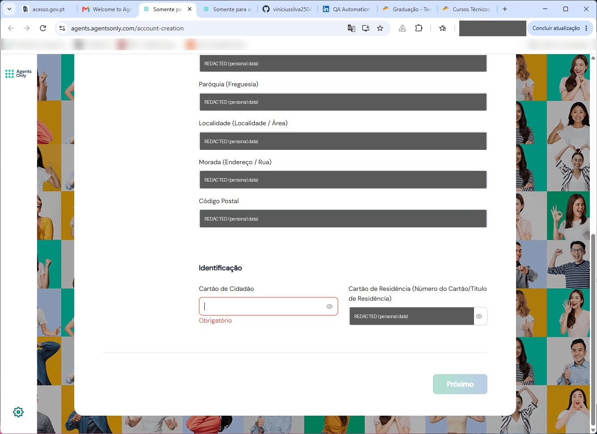
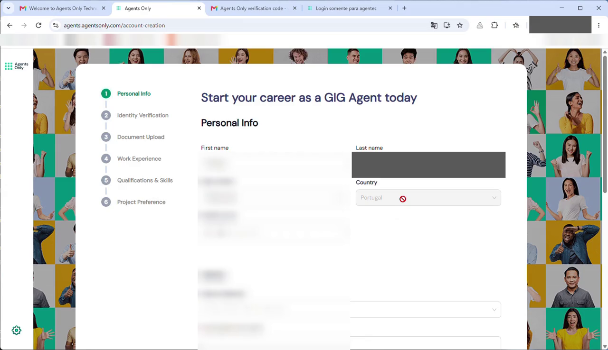
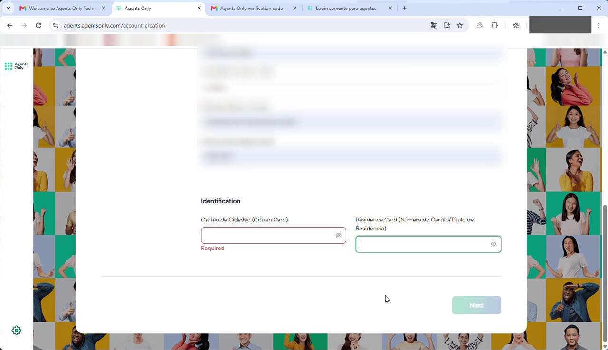

# BUG-001: "Cartão de Cidadão" is always required, so foreign residents cannot complete account creation

| Field | Value |
|---|---|
| **ID** | BUG-001 |
| **Title** | Account creation, step 1 "Personal Info": "Cartão de Cidadão" (Citizen Card) is required even when "Residence Card" (Título de Residência) is filled, so "Next" stays disabled and foreign residents of Portugal cannot continue |
| **Product / URL** | Agents Only portal: `https://agents.agentsonly.com/account-creation` |
| **Component** | Account creation wizard, step 1 "Personal Info", "Identification" section |
| **Environment** | Desktop web browser. The screenshots show a Chromium-based browser that looks like Google Chrome, on what appears to be Windows (judging by the window controls). Browser version, OS version and screen size were **not recorded**. |
| **Date found** | On or before 17 Nov 2026. The defect was first reported to the company on 17 Nov 2026 at 22:58 (Europe/Lisbon). The exact first occurrence was not recorded. |
| **Reporter** | [@viniciussilva2504](https://github.com/viniciussilva2504), a real candidate going through the onboarding flow |
| **Severity** | **Blocker** for foreign nationals living in Portugal who hold a residence permit and no "Cartão de Cidadão". It does not affect Portuguese citizens. |
| **Priority (suggested)** | **High**: it stops a whole group of candidates at the very first step of onboarding, and there is no workaround in the UI. |
| **Reproducibility** | Seen on every attempt shown in the evidence: one screenshot and one screen recording. The number of attempts was not recorded. |
| **Status** | **Open / unresolved.** Reported to the company. As of 18 Nov 2026 no fix or workaround had been given. |

## Summary

On step 1 of the account creation wizard, the "Identification" section has two inputs:

- "Cartão de Cidadão (Citizen Card)": the Portuguese national ID card
- "Residence Card (Número do Cartão/Título de Residência)": the residence card / residence permit number

The "Cartão de Cidadão" field is validated as **always required**. A valid residence-permit number in "Residence Card" does not satisfy the validation, so the "Next" button never becomes enabled. The "Country" field is locked to "Portugal". The form offers no nationality field, no document-type selector (for example a passport), and no help link.

The "Cartão de Cidadão" is the Portuguese national identity card. It is issued to Portuguese citizens and, **optionally**, to Brazilian citizens who have been granted the Statute of Equality (Estatuto de Igualdade, Treaty of Porto Seguro). Other foreign residents, and Brazilian residents without that statute, identify themselves with a residence permit ("Título de Residência"), which is what the "Residence Card" field asks for. These candidates cannot finish step 1. The reporter is a foreign national living legally in Portugal with a residence permit and no Cartão de Cidadão.

> Language note: the page is rendered in English with Portuguese terms in parentheses, for example "Cartão de Cidadão (Citizen Card)" and "Next". The screenshot sent to the company shows the page in Portuguese ("Identificação", "Obrigatório", "Próximo"). This **appears** to be the browser's automatic translation, because the URL bar shows the translate icon and the address labels read like machine translation, but that is not confirmed. Both sets of labels are quoted below.

## Preconditions

1. The candidate received the Agents Only invitation and signed in to the portal (email + 6-digit verification code).
2. The candidate is a foreign national living in Portugal who holds a Portuguese residence permit ("Título de Residência / Autorização de Residência") and **no** "Cartão de Cidadão".
3. The candidate is on `https://agents.agentsonly.com/account-creation`, step 1 "Personal Info".

## Steps to reproduce

1. Open `https://agents.agentsonly.com/account-creation` while signed in.
2. On step 1 "Personal Info", fill in "First name", "Last name", "Date of Birth" and "Mobile phone".
3. Look at the "Country" field: it is pre-set to "Portugal" and cannot be edited (the mouse pointer turns into a "not-allowed" cursor).
4. Fill in the "Address" block: "District (Distrito)", "Municipality (Concelho)", "Parish (Freguesia)", "Localidade (Locality / Area)", "Morada (Address / Street)", "Postal Code (Código Postal)".
5. In the "Identification" section, leave "Cartão de Cidadão (Citizen Card)" empty. A residence-permit holder has no such number.
6. In "Residence Card (Número do Cartão/Título de Residência)", enter a valid residence permit number.
7. Try to click "Next" ("Próximo").

## Actual result

- "Cartão de Cidadão" is outlined in red with the message "Required" ("Obrigatório").
- The "Residence Card" field accepts the value and shows no error.
- "Next" ("Próximo") stays **disabled**, so the candidate cannot reach step 2 "Identity Verification".
- "Country" is locked to "Portugal". There is no nationality field, no document-type selector (for example a passport), and no help or contact link on the page.
- The only way to continue would be to enter a Cartão de Cidadão number the candidate does not have, which would mean submitting false information.

## Expected result

- The "Identification" section accepts **either** a "Cartão de Cidadão" **or** a "Residence Card" / "Título de Residência" number. Exactly one of the two must be provided.
- Once one valid document number is entered and the other required fields are valid, "Next" becomes enabled.
- If the business needs one specific document, the form says so clearly and offers a supported alternative (for example a document-type selector or a passport option), or a help link.

## Business impact

- **Candidates lost at step 1:** every foreign resident without a Cartão de Cidadão is blocked from onboarding. The company has to handle these cases manually by email, or loses the candidates.
- **Support load:** each blocked candidate is likely to contact recruitment or support, as happened here.
- **Data quality and compliance risk:** the only way past the form is to type a fake or someone else's citizen card number, which pollutes identity data and can break identity verification later.
- **Inclusion / fairness:** the form excludes legally resident foreign workers, which can affect hiring diversity and the employer brand.

## Root cause hypothesis

> **Hypothesis only.** It is not confirmed, because there is no access to the source code or the API.

- The client-side validation schema probably marks the Cartão de Cidadão field as unconditionally required (for example `citizenCard: required()`), while the residence card field is optional. Nothing links the two fields together (no "either/or" rule).
- Because "Country" is fixed to "Portugal", the form may assume every candidate is a Portuguese national, so the citizen card was made mandatory for all Portuguese registrations.
- It is unknown whether the backend enforces the same rule. Fixing only the UI might still fail on submit.

## Suggested fix

1. Change the validation to "exactly one of" `citizenCard` / `residenceCard`: show an error only when both are empty (and, optionally, when both are filled), and enable "Next" when exactly one valid number is present.
2. Add a "Document type" selector (Cartão de Cidadão / Título de Residência / Passport, if the business accepts it) that shows the matching field and validation rule.
3. Apply the same rule in the backend API, and add automated tests for the combinations in the [test suite](../test-suite/identification-test-suite.xlsx).
4. Add help text or a help link next to "Identification" explaining which documents are accepted, plus a contact option for candidates who are blocked.

## Evidence

All media are **redacted copies**. Personal data (name, date of birth, phone, address, postal code, residence permit number, verification code, session token in the URL, browser profile and bookmarks) has been covered or blurred.

**1. Identification section with "Residence Card" filled. "Cartão de Cidadão" shows "Obrigatório" (Required) and "Próximo" (Next) is disabled.** This is the screenshot that was sent to the company (browser-translated to Portuguese).

**2. "Country" field locked to "Portugal": a "not-allowed" cursor appears on hover.** Still frame from the screen recording, about 0:25.

**3. "Cartão de Cidadão (Citizen Card)" marked "Required" and "Next" disabled.** Still frame from the screen recording, about 0:50. Both fields are empty in this frame.

**4. Screen recording (redacted, about 58 s, no audio):** [`evidence/screen-recording-redacted.mp4`](../evidence/screen-recording-redacted.mp4). It shows sign-in with a 6-digit code, the account creation page loading, step 1 being filled in, the locked "Country" field, and the "Identification" section with "Required" and a disabled "Next". The residence card number is **not** typed in the recording; that state is shown in screenshot 1.

## Communication timeline

All times are Europe/Lisbon (UTC+0).

| Date / time | Event |
|---|---|
| 17 Nov 2026, 16:21 | Agents Only sends the "Welcome to Agents Only Technologies - Create your Agents Only Account" email with account creation instructions. Its ID tips cover only India, Egypt and the Philippines, with no guidance for Portugal. |
| 17 Nov 2026, 22:58 | The reporter emails the company's recruitment and support teams. He describes the blocker, explains that he is a foreign resident with a Portuguese residence permit and no Cartão de Cidadão, and attaches his supporting documents. |
| 18 Nov 2026, 15:58 | The recruitment team replies and asks for a screenshot of the Personal Information page, specifically the Identification section. |
| 18 Nov 2026, 16:42 | The reporter replies to the recruitment team with the screenshot (evidence item 1). |
| As of 18 Nov 2026 | No further reply, fix or workaround. **Unresolved.** |

## Current status

**Open.** The reporter is waiting for the company to respond. This write-up will be updated if the defect is fixed or a workaround is provided.
